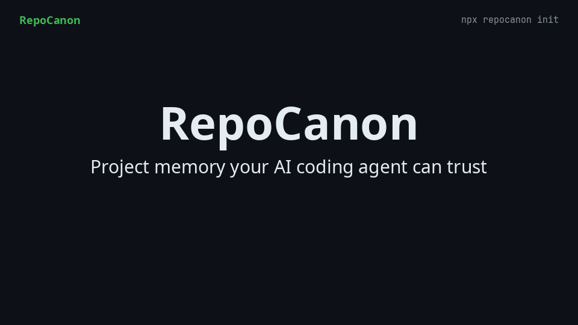
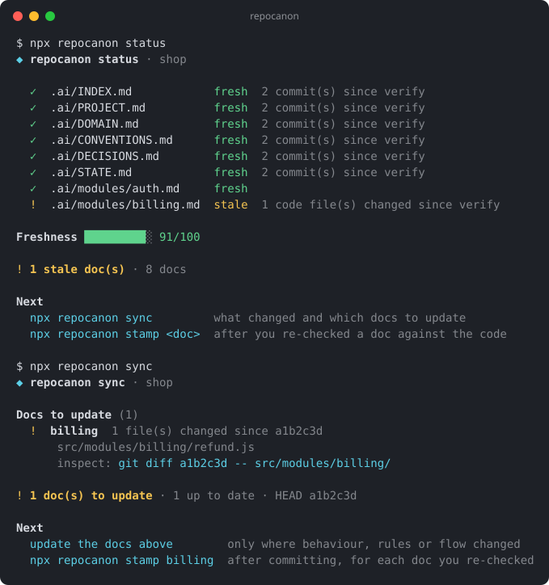

# RepoCanon

**Verified AGENTS.md and project memory for AI coding agents.** One small `.ai/` folder tells Claude Code, Cursor, GitHub Copilot, OpenAI Codex, Gemini CLI, Windsurf and Cline how your project works, and git checks that it is still true.

[](https://www.npmjs.com/package/repocanon)
[](https://www.npmjs.com/package/repocanon)
[](LICENSE)
[](https://nodejs.org)
[](package.json)
[](#connect-the-mcp-server)

[](https://mcprush.com/to/repocanon-mcp?ref=badge)

Sponsored by **[Framimo](https://framimo.com)** — turn any clip into GIF, WebP, AVIF or MP4, right in your browser.

<p align="center">
  
</p>

**In 30 seconds**
- **What it is:** a small, local project-memory layer (`AGENTS.md` + `.ai/`) that every AI coding agent reads: the rules, decisions and gotchas your code can't show.
- **What it does:** one command sets it up for all your tools, delivers each module's rules to the agent while it works, and checks every rule against the code with git, so stale ones are flagged, not trusted.
- **How it helps:** agents follow your project's rules instead of guessing (8% → 100% of tasks passed once the rules were written down), and they keep the docs correct as they work. It runs locally, calls no LLM and has zero dependencies.

## Why

- **Agents re-learn your repo on every task.** They scan files, burn tokens, and still miss the rules code doesn't show: state machines, money and permission invariants, why a choice was made.
- **Hand-written `CLAUDE.md` and rules files rot silently.** Nobody notices when they stop matching the code.
- **Every tool wants its own file.** CLAUDE.md, `.cursor/rules`, Copilot instructions, GEMINI.md, `.windsurfrules`, `.clinerules`…

RepoCanon keeps **one** knowledge layer (`AGENTS.md` + `.ai/`), points every tool you use at it, and uses git to tell you which docs went stale after a code change. It runs locally, calls no LLM and has zero dependencies.

## Quick start

Requires Node.js 18+ and a git repository.

```bash
cd your-project
npx repocanon init          # pick your AI tools (↑/↓, space, enter)
```

<details>
<summary>What you'll see</summary>

<!-- example:init -->
```text
◆ repocanon init · shop

  Stack  Node.js, Express
  Tools  Claude Code, Cursor

Files
  +  .repocanon.json            created
  +  .ai/.gitignore             created
  +  .ai/INDEX.md               created
  +  .ai/PROJECT.md             created
  +  .ai/DOMAIN.md              created
  +  .ai/CONVENTIONS.md         created
  +  .ai/DECISIONS.md           created
  +  .ai/STATE.md               created
  +  .ai/prompts/update.md      created
  +  .ai/modules/_TEMPLATE.md   created
  +  AGENTS.md                  created
  +  CLAUDE.md                  created
  +  .cursor/rules/project.mdc  created

Generated
  ✓  Module map    2 module(s) → .ai/INDEX.md
  ·  Scoped rules  up to date
  ✓  Skills        3 file(s) updated: .ai/skills/rc-verify-change/SKILL.md, .claude/skills/rc-verify-change/SKILL.md, .agents/skills/rc-verify-change/SKILL.md

✓ Knowledge layer created

Next
  npx repocanon setup        connect the MCP server to your tools
  npx repocanon prompt fill  brief for your agent to fill the docs (or ask it over MCP)
  npx repocanon doctor       check the result
```

</details>

Then let your agent fill the docs. Either:

- **With MCP** (`npx repocanon setup`, [details](#connect-the-mcp-server)): tell your agent *"Fill the RepoCanon docs"*. It calls `rc_prepare_fill` and writes `.ai/*.md` itself.
- **Without MCP:** run `npx repocanon prompt fill` and paste the output into your agent.

Finally, check the result and commit:

```bash
npx repocanon doctor        # lint: size caps, TODOs, broken paths, token budget, content agents can infer
git add -A && git commit -m "Add RepoCanon knowledge layer"
npx repocanon stamp --all   # mark the docs verified at that commit
git commit -am "Verify RepoCanon docs"
```

<details>
<summary>What <code>doctor</code> shows</summary>

<!-- example:doctor -->
```text
◆ repocanon doctor · shop

Warnings (1)
  !  scoped rule files are out of date (2: .cursor/rules/rc-billing.mdc, AGENTS.md) — run: npx repocanon rules

Info (1)
  i  27 TODO placeholder(s) remain in .ai/ — run: repocanon prompt fill

Token budget
  Entry context (AGENTS + PROJECT + INDEX)  ~662 tokens
  Whole repo source                         ~820 tokens
  Entry share of the repo                   80.73%
  → estimates: word-aware for docs, bytes/4 for code

Freshness █████████░ 91/100

! 1 warning · 1 note(s)

Next
  npx repocanon prompt fill
  npx repocanon rules
  npx repocanon doctor       run again after fixing
```

</details>

### Reading the output

Every command prints the same shape: a header, rows, a one-line verdict, then **Next**: the exact commands to run. Symbols always come with a word, so the output also works without colour (`NO_COLOR=1`, `--no-color`, CI logs, screen readers).

| Symbol | Means | | Symbol | Means |
|---|---|---|---|---|
| `✓` | ok / fresh | | `+` | file created |
| `!` | warning / stale | | `~` | file updated |
| `✗` | error / broken | | `-` | file removed |
| `i` | info / unverified | | `=` / `·` | unchanged |

Every command has `--help` with options and examples: `npx repocanon status --help`. `--json` and `--format=github` give machine-readable output for scripts and CI.

### Already have CLAUDE.md, Cursor rules or a Cline memory bank?

```bash
npx repocanon adopt --dry-run   # preview: what goes where, what gets removed
npx repocanon adopt             # import into .ai/ (creates it if needed)
git add -A && git commit -m "Adopt RepoCanon"
npx repocanon adopt --move      # originals become pointers, so tools stop reading two copies
```

`adopt` reads `CLAUDE.md`, `GEMINI.md`, `.windsurfrules`, `.clinerules`, `.github/copilot-instructions.md`, `.cursorrules`, always-on `.cursor/rules/*.mdc`, repo-wide Copilot instructions and Cline's `memory-bank/`. It routes each section to the right doc (glossary → DOMAIN, decisions → DECISIONS, progress → STATE, overview → PROJECT, the rest → CONVENTIONS), drops directory trees, dependency lists, pasted code and secrets, and tells you how many tokens that saved. Rules that are already scoped to certain files stay where they are. Re-running skips what was already imported; `--move` never touches a file with uncommitted changes.

## What you get

```
AGENTS.md                 entry point every agent reads: commands, a digest of your rules and decisions, Definition of Done
.ai/
  PROJECT.md              purpose, stack, boundaries
  INDEX.md                path → module map (auto block refreshed by `analyze`)
  DOMAIN.md               business rules, states, invariants, glossary
  CONVENTIONS.md          coding style and patterns
  DECISIONS.md            why things are built this way
  STATE.md                current focus and recent changes
  modules/<name>.md       one doc per module: purpose, invariants, flow, code map, gotchas
.repocanon.json           config (presets, modules, excludes, chosen tools)
CLAUDE.md, .cursor/…      small pointer files, only for the tools you pick
```

Docs are a semantic index, never a copy of the code. When docs and code disagree, **code wins** and the doc gets fixed.

## Choosing tools

`init` opens a picker for the AI tools that should read the knowledge layer. `AGENTS.md` is always written; each tool you pick gets a small pointer file:

| id | Tool | File written |
|---|---|---|
| `claude` | Claude Code | `CLAUDE.md` (`@AGENTS.md` import) |
| `cursor` | Cursor | `.cursor/rules/project.mdc` |
| `copilot` | GitHub Copilot | `.github/copilot-instructions.md` |
| `gemini` | Gemini CLI / Antigravity | `GEMINI.md` |
| `windsurf` | Windsurf | `.windsurfrules` |
| `cline` | Cline | `.clinerules` |
| `codex` | OpenAI Codex / ChatGPT | nothing extra — reads `AGENTS.md` natively |

- **Re-run any time.** `init` reopens the picker with your saved choice and marks each tool `set up` or `detected`. If nothing changed it prints `Up to date`.
- **Untick a tool** and `init` offers to remove its RepoCanon block. Only that block goes: your own text stays, and a file is deleted only if nothing else is in it.
- **Scripts and CI** (no terminal): `--targets=claude,cursor`, `--targets=all` or `--targets=none`; `--yes` keeps the saved choice; `--prune` removes blocks of tools you no longer select.

## Scoped rules: module knowledge exactly where the agent is editing

`npx repocanon rules` turns each filled module doc into rule files that a tool loads **only while the agent edits that module's files** — no tool call, no extra tokens anywhere else:

| Tool | File | Loaded when editing |
|---|---|---|
| Cursor | `.cursor/rules/rc-<module>.mdc` (`globs`, `alwaysApply: false`) | files under the module's `code_paths` |
| GitHub Copilot | `.github/instructions/rc-<module>.instructions.md` (`applyTo`) | the same files |
| Codex, Claude Code (opt-in) | `<module folder>/AGENTS.md` with a pointer to the module doc | anything in that folder |

- `.ai/modules/<module>.md` stays the single source. Generated files say so in their header; edit the doc, then run `rules` again.
- Files are written only for the tools you selected in `init`. Nested `AGENTS.md` pointers are off by default; turn them on with `"nestedAgents": true` in `.repocanon.json`.
- Modules whose doc is still the empty template get nothing. Removed docs and deselected tools have their generated files cleaned up; your own rule files are never touched.
- `init` runs `rules` for you, `doctor` warns when the files are out of date, and `rules --check` fails CI until they're regenerated.

## Skills: the repo's own checks, loaded only when needed

`npx repocanon skills` (also run by `init`) writes an [Agent Skill](https://agentskills.io) that tells agents how to verify a change in *this* repo: `.ai/skills/rc-verify-change/SKILL.md`. Only its one-line description sits in the agent's context; the body loads when the agent is about to say "done".

- Commands come from the repo itself: `package.json` / `composer.json` scripts (run with your package manager), `Makefile`, `justfile`, `Taskfile.yml`, and the `run:` steps of `.github/workflows/*.yml` or `.gitlab-ci.yml`. Each one says where it was found, duplicates are merged, and steps run in order: format → lint → typecheck → test (an aggregate `make check` comes first).
- Installs, deploys, publishes, lines using CI secrets, and watch or dev servers are never included.
- `.ai/skills/` is the one place to edit. Change the generated skill and RepoCanon stops regenerating it; add your own `.ai/skills/<name>/SKILL.md` and it is copied out too.

| Tool | Skills folder |
|---|---|
| Claude Code | `.claude/skills/<name>/SKILL.md` |
| Cursor, Codex, Gemini CLI, GitHub Copilot (VS Code) | `.agents/skills/<name>/SKILL.md` |

Copies are written only for the tools you chose, carry a "Generated by RepoCanon" header, and are removed when you deselect the tool. A skill of the same name that RepoCanon didn't write is never overwritten. Skills with an invalid name (lowercase, hyphens, must match the folder), a missing description or a secret are not copied, and `doctor` says why. Windsurf and Cline don't read skills folders yet.

## Monorepos

RepoCanon reads pnpm, npm, yarn and bun workspaces, lerna, nx (`project.json`), turbo, `go.work`, Cargo workspaces and uv workspaces. Then:

- **Each library package is one module**: `packages/ui` (`@acme/ui`) → `ui`.
- **An app is split by feature** when its framework's folders show two or more: `apps/web` (Next.js) → `web-billing`, `web-pricing`; `apps/api` (NestJS) → `api-users`, `api-billing`. Otherwise the app is one module.
- Root tooling outside the packages belongs to no module. Two packages with the same name are named by path (`apps-web`, `packages-web`).

`.ai/INDEX.md` gets a Workspace table (package, path, app or package, stack), and the fill brief says it's a monorepo. To split differently, set `moduleRoots` or `modules`, or a fixed `preset`, in `.repocanon.json`; any of those turns the workspace split off.

## Claims: rules tied to the code that proves them

A plain rule in a doc is only as fresh as the whole doc. Annotate the rules that matter, and RepoCanon checks each one on its own:

```markdown
## Invariants
- Money is integer cents. <!-- rc: anchor=src/money/cents.js#toCents -->
- Floats are rejected. <!-- rc: test=test/money.test.js#rejects floats -->
- Never round twice.
```

| Tier | Written as | Checked how | Goes wrong when |
|---|---|---|---|
| **enforced** | `test=path#test name` | the test file exists and contains that name; CI runs it | the test is deleted or renamed → **broken** |
| **anchored** | `anchor=path#symbol` (`Class.method` works; a bare path anchors the whole file) | `stamp` stores a hash of the symbol's body in `.ai/canon.lock`; reformatting doesn't change it | the body's logic changes → **stale**; the symbol is gone → **broken** |
| **asserted** | a plain bullet | the doc's own `verified_at` | — |

- `repocanon claims` lists every claim with its tier and state. It exits 1 on a broken claim, or on a stale one with `--ci`.
- `doctor` reports broken claims as errors and stale ones as warnings.
- `rc_context` and the edit-time hook mark a stale claim on its doc, even when the doc as a whole looks fresh.
- `stamp <doc>` (and `rc_stamp`) lock the claims of the docs it verifies. A claim whose code has uncommitted changes isn't locked.
- Hashes are computed by the tool, never written by hand. Symbol lookup is pattern-based (JS/TS, Python, Go, Rust, PHP, Java-style methods), not a parser; anchor to the file if a symbol isn't found.

## Daily workflow



After you or your agent change code:

```bash
npx repocanon sync          # which docs are stale, which files changed, what to inspect
# your agent updates the affected .ai/*.md (or: npx repocanon prompt update → paste)
git commit -am "Update billing + docs"
npx repocanon stamp billing # mark only the docs you actually re-checked (code must be committed)
```

The stamp edits `verified_at` (and `verified_by: human`) in that doc; it rides along with your next commit.

After a code change, `status` and `sync` show what drifted:

<!-- example:status -->
```text
◆ repocanon status · shop

  ✓  .ai/INDEX.md            fresh  2 commit(s) since verify
  ✓  .ai/PROJECT.md          fresh  2 commit(s) since verify
  ✓  .ai/DOMAIN.md           fresh  2 commit(s) since verify
  ✓  .ai/CONVENTIONS.md      fresh  2 commit(s) since verify
  ✓  .ai/DECISIONS.md        fresh  2 commit(s) since verify
  ✓  .ai/STATE.md            fresh  2 commit(s) since verify
  ✓  .ai/modules/auth.md     fresh
  !  .ai/modules/billing.md  stale  1 code file(s) changed since verify

Freshness █████████░ 91/100

! 1 stale doc(s) · 8 docs

Next
  npx repocanon sync         what changed and which docs to update
  npx repocanon stamp <doc>  after you re-checked a doc against the code
```

<!-- example:sync -->
```text
◆ repocanon sync · shop

Docs to update (1)
  !  billing  1 file(s) changed since a1b2c3d
      src/modules/billing/refund.js
      inspect: git diff a1b2c3d -- src/modules/billing/

! 1 doc(s) to update · 1 up to date · HEAD a1b2c3d

Next
  update the docs above        only where behaviour, rules or flow changed
  npx repocanon stamp billing  after committing, for each doc you re-checked
```

With MCP connected, just say *"update the context docs"*: the agent calls `rc_sync_report`, edits the docs, records decisions and progress with `rc_propose_adr` / `rc_checkpoint_state`, stamps what it re-checked with `rc_stamp` and finishes with `rc_verify`. Agent stamps write `verified_by: agent`: the doc counts as fresh, but `status` shows `fresh (agent)` and `doctor` and the PR report list it so a human can re-check. A human `repocanon stamp` replaces it.

Optional: `npx repocanon hook` installs a pre-commit hook. It warns when code changes without any `.ai/` update (never blocks), and **blocks** a commit that would add an API key, token or password to `AGENTS.md` or `.ai/` docs (`git commit --no-verify` overrides). The secret check needs RepoCanon installed locally (`npm i -D repocanon`) or globally.

## Connect the MCP server

`repocanon mcp` is a stdio [Model Context Protocol](https://modelcontextprotocol.io) server. Agents use it to fetch a budgeted context pack instead of scanning the repo, and to update the docs without copy-paste.

**Let RepoCanon write the config:**

```bash
npx repocanon setup              # the tools you picked in init
npx repocanon setup cursor copilot
```

<!-- example:setup -->
```text
◆ repocanon setup · shop

  +  .mcp.json         created · repocanon server added
  +  .cursor/mcp.json  created · repocanon server added

✓ MCP server registered in 2 config(s)

Next
  restart or reload your tool                     so it starts the server
  ask your agent: "use rc_context for this task"  to check it works
```

`setup` adds only its own `repocanon` entry: other servers and settings in the file stay as they are, and re-running it changes nothing. A file that isn't plain JSON (for example `.vscode/mcp.json` with comments) is left alone and you get the block to paste. Tools with a global config (Windsurf, Cline, Codex) get a ready-to-paste snippet with your project path.

**Or add it by hand.** Most tools take this block:

```json
{
  "mcpServers": {
    "repocanon": { "command": "npx", "args": ["-y", "repocanon", "mcp"] }
  }
}
```

| Tool | Where it goes |
|---|---|
| Claude Code | `.mcp.json` in the project, or `claude mcp add repocanon -- npx -y repocanon mcp` |
| Cursor | `.cursor/mcp.json` in the project |
| VS Code (Copilot agent mode) | `.vscode/mcp.json` — this file uses `"servers"` instead of `"mcpServers"` |
| Gemini CLI | `.gemini/settings.json` in the project |
| Windsurf | `~/.codeium/windsurf/mcp_config.json` (Settings → Cascade → MCP Servers) |
| Cline | Cline panel → MCP Servers → Configure (`cline_mcp_settings.json`) |
| OpenAI Codex | `~/.codex/config.toml`: `[mcp_servers.repocanon]` with `command = "npx"`, `args = ["-y", "repocanon", "mcp", "--root=/abs/path"]` |

The server works on the folder it starts in. Global configs (Windsurf, Cline) usually start outside your project, so add the path: `"args": ["-y", "repocanon", "mcp", "--root=/abs/path/to/project"]`.

| MCP tool | What it returns |
|---|---|
| `rc_context` | Budgeted context for a task: rules + the most relevant module docs, with stale docs labelled so the agent trusts the code there. Call it first. |
| `rc_module` | One module's full doc |
| `rc_find_owner` | Which module owns a file |
| `rc_status` | Freshness of every doc vs git |
| `rc_prepare_fill` | Evidence-loaded brief for writing the docs |
| `rc_sync_report` | What changed since each doc was verified |
| `rc_propose_adr` | **Writes** a decision to its own file, `.ai/decisions/<date>-<slug>.md`, so parallel branches never conflict |
| `rc_checkpoint_state` | **Writes** focus, in-progress, known issues and a change line to `.ai/STATE.md`; never marks anything verified |
| `rc_stamp` | **Writes** `verified_at` + `verified_by: agent` for named docs; refuses uncommitted code |
| `rc_verify` | The "am I done?" check: errors, stale docs, score, then PASS or FAIL |

Write tools validate before touching a file: one line per field, length limits, and no secrets, pasted code, trees or dependency lists. A refused write changes nothing. Every tool carries MCP annotations (`readOnlyHint`), so clients can auto-approve the read-only ones.

## Claude Code plugin

The plugin connects Claude Code to the knowledge layer with one install, and keeps the docs current while Claude works:

```text
/plugin marketplace add awalhadi/repo-canon
/plugin install repocanon@repocanon
```

| Part | What it does |
|---|---|
| MCP server | `rc_context`, `rc_sync_report` and the other tools above, for the project you open |
| Session start | Tells Claude the layer exists, to call `rc_context` before exploring, and which docs are stale |
| First read or edit in a module | Adds that module's Invariants and Gotchas (≤ ~300 tokens, once per module per session, labelled when the doc is stale), so the rules arrive before Claude changes the code, without an MCP call |
| End of turn | If Claude changed a module's code but not its doc, asks it **once** to update the doc or say no change is needed |
| `repocanon` skill | The workflow: context first, update docs after changes, never paste code, file lists or secrets |

The hooks do nothing in projects without an `.ai/` folder. They run `npx repocanon`, so the first session downloads it once.

## Use in CI

The GitHub Action checks every pull request, annotates problems on the changed lines, and keeps one summary comment up to date:

```yaml
# .github/workflows/repocanon.yml
name: repocanon
on: [pull_request]
permissions:
  contents: read
  pull-requests: write          # for the summary comment
jobs:
  docs:
    runs-on: ubuntu-latest
    steps:
      - uses: actions/checkout@v4
        with: { fetch-depth: 0 }   # full history, so freshness can be computed
      - uses: actions/setup-node@v4
        with: { node-version: 20 }
      - uses: awalhadi/repo-canon@v0.6
        with:
          fail-on: error           # error (default) | stale | never
```

The comment looks like this:

> ### RepoCanon: ⚠️ 1 module(s) changed without their docs
> | Module | Code changed | Doc |
> |---|---|---|
> | `billing` | 3 file(s) | ⚠️ not updated — `.ai/modules/billing.md` |
>
> **Freshness 82/100 · 1 stale, 0 broken, 2 unverified**

Only meaningful code changes count: edits to tests, prose docs and lockfiles, and whitespace-only changes, never make a doc stale. Add your own patterns with `driftIgnore`, or set `"drift": "all"` to count every change.

**Without the action** — the same checks as plain commands:

```yaml
# .github/workflows/repocanon.yml
name: repocanon
on: [pull_request]
jobs:
  docs:
    runs-on: ubuntu-latest
    steps:
      - uses: actions/checkout@v4
        with: { fetch-depth: 0 }   # full history, so verified_at commits resolve
      - uses: actions/setup-node@v4
        with: { node-version: 20 }
      - run: npx -y repocanon doctor --ci   # fails on errors; add --strict to fail on warnings too
      - run: npx -y repocanon status --ci   # fails on stale or broken docs
      - run: npx -y repocanon rules --check # fails when scoped rule files are out of date
```

## Commands

| Command | What it does |
|---|---|
| `init [--targets=a,b\|all\|none] [--yes] [--prune] [--force]` | Create `.ai/`, `AGENTS.md`, `.repocanon.json` and pointer files for the tools you pick; detects stack and run/test commands |
| `adopt [--dry-run] [--move] [--json]` | Import existing agent rules (CLAUDE.md, Cursor/Copilot rules, GEMINI.md, .windsurfrules, .clinerules, memory-bank/) into `.ai/`, minus inferable content and secrets; `--move` retires the originals |
| `analyze [--scaffold]` | Refresh the module map in `.ai/INDEX.md`; `--scaffold` creates module doc stubs |
| `doctor [--ci] [--strict] [--format=github] [--json]` | Lint the layer: secrets (error), size caps, TODOs, broken paths, missing pointers, token budget, and content agents can read from the code (directory trees, dependency lists, pasted code, file catalogues) |
| `status [--ci] [--json]` | Each doc: fresh / stale / broken / unverified, plus the Freshness Score (0–100) |
| `report [--base=ref] [--format=markdown\|json]` | Pull-request summary: modules changed with or without their docs, Freshness Score, secrets, out-of-date rules |
| `sync [--write] [--since=ref] [--json]` | Code changed since each doc was verified → docs to update (`--write` saves `.ai/.sync-report.md`) |
| `context [words…] [--files=a,b] [--max=4000]` | Print the budgeted context pack for a task; stale docs are labelled |
| `stamp <name…> \| --all [--force]` | Mark docs verified at the current commit; refuses when their code has uncommitted changes |
| `prompt fill [--compact]` | Brief to paste into an agent so it fills the docs |
| `prompt update` | Brief for updating docs after code changes |
| `claims [--ci] [--json]` | Rules tied to code (`anchor=`) or tests (`test=`): tier and state of each; exits 1 on a broken claim (and a stale one with `--ci`) |
| `secrets [--staged] [--json] [--quiet]` | Scan `AGENTS.md`, `.ai/` and tool pointer files (or their staged versions) for API keys, tokens and passwords, and for unsafe instructions (hidden characters, instruction overrides, `curl … \| sh`); exits 1 if any are found |
| `hook` | Install the pre-commit hook: warns on undocumented code changes, blocks secrets and unsafe instructions in docs |
| `rules [--check] [--json]` | Write per-module scoped rule files (Cursor, Copilot, optional nested `AGENTS.md`); `--check` exits 1 if out of date |
| `skills [--check] [--json]` | Write the verify-a-change skill and copy `.ai/skills/` to each tool's skills folder; `--check` exits 1 if out of date |
| `setup [tool…\|all] [--json]` | Register the MCP server in each tool's config (default: the tools `init` set up) |
| `mcp` | Start the MCP server on stdio |
| `agent-hook <session-start\|stop\|pre-edit>` | Output for agent hooks: session briefing, end-of-turn doc reminder, a module's rules on the first read or edit there (used by the Claude Code plugin) |

Global flags: `--root=<dir>` runs against another folder; `--version`; `--help`.

## Configuration

`.repocanon.json` (created by `init`):

```json
{
  "preset": "auto",
  "moduleRoots": ["src/domains"],
  "modules": { "checkout": ["app/Services/Checkout/", "app/Models/Order.php"] },
  "exclude": ["legacy/", "vendor/"],
  "targets": ["claude", "cursor"],
  "nestedAgents": false,
  "driftIgnore": ["src/generated/", "*.snap"]
}
```

- `preset`: `auto` (from the detected stack) or one of `laravel nextjs nuxt react vue nestjs node fastapi django rails go tauri`. Presets merge one domain across layers:

  | Preset | Finds |
  |---|---|
  | Laravel | `Billing` = Services + Actions + Controllers + Pages folders; flat apps too: `Invoice.php` + `InvoiceController.php` + `StoreInvoiceRequest.php` → `invoice`; nwidart `Modules/`, Filament resources |
  | Next.js | App Router segments (`(groups)` walked through; `[dynamic]`, `_private`, `@slots` skipped; `api/billing` joins `billing`), plus `src/features`, `src/modules` |
  | FastAPI | `routers/users.py` + `models/user.py` + `schemas/user.py` → `user` (under `app/` or `src/<pkg>/`), plus `app/modules`, `app/domains` |
  | Go | `internal/*`, `pkg/*`, `cmd/*`; layered apps merged by domain (`internal/handler/user` + `internal/service/user` → `user`) |
  | NestJS | every `*.module.ts` folder except the `app.module.ts` shell |

  A name has to appear in at least two layers to become a module, so a lone `User.php` or `health.py` doesn't.
- `moduleRoots`: extra folders whose child folders are modules.
- `modules`: explicit module → paths; overrides a detected module with the same name.
- `exclude`: path prefixes ignored everywhere.
- `targets`: the AI tools `init` set up (managed by the picker).
- `nestedAgents`: also write a pointer `AGENTS.md` into each module folder (default `false`).
- `entryDigest`: keep a digest of `.ai/CONVENTIONS.md` and `.ai/DECISIONS.md` (one line per decision, about 700 tokens at most) in the `AGENTS.md` block (default `true`). Agents reliably follow what is in their entry file and often skip a pointer to another file; `false` leaves only the pointer. `rules` regenerates the digest, and `doctor`, `rules --check` and the PR report flag it when it falls behind.
- `driftIgnore`: extra paths whose changes never make a doc stale (folder prefixes ending in `/`, `*` and `**` globs). Tests, prose docs, lockfiles and whitespace-only edits are always ignored; `"drift": "all"` turns that off.

## Benchmark

Does project knowledge help, and does RepoCanon deliver it better than a hand-written `AGENTS.md`? Claude Code (`claude-sonnet-5-5`, CLI 2.1.178) ran 8 tasks in JavaScript, Python, PHP and Rust projects, 5 times under each of 4 conditions: 160 runs in all, on 2026-10-27. Each task touches project rules the code doesn't reveal. A run passes when hidden tests **and** rule checks pass.

| Condition | Tasks passed (95% CI) | Rule checks | Median tokens | Mean cost |
|---|---|---|---|---|
| No project docs | 3/40 · 8% (3–20%) | 58% | 194k | $0.36 |
| Hand-written `AGENTS.md` | 40/40 · 100% (91–100%) | 100% | 236k | $0.38 |
| RepoCanon, pointer only (0.5) | 40/40 · 100% (91–100%) | 100% | 415k | $0.62 |
| RepoCanon with rules digest (0.6) | 40/40 · 100% (91–100%) | 100% | 380k | $0.58 |

What this shows, and what it doesn't:
- **Writing the rules down is what matters.** Without them the agent passed 8% of runs; with them, every run passed.
- **On these tasks, RepoCanon was no more correct than a good hand-written `AGENTS.md`, and it cost about 1.5× more.** Its agents read 6+ `.ai/` docs per run and made about twice as many edits, following the Definition of Done in `AGENTS.md`. Both knowledge formats hit 100%, so this benchmark can't separate them on correctness.
- **The rules digest added in 0.6 cut cost by 8%** against the pointer-only design. Claude Code never called the MCP tools or the skill in these headless runs; it read the files directly.
- **Where RepoCanon should help is not measured here:** docs drifting from code over time, large repos, and many tools. The next benchmark round targets those.

Method, tasks and how to rerun it: [bench/README.md](bench/README.md). Raw results: [bench/results/2026-10-27/](bench/results/2026-10-27/summary.md).

### Drift pilot: a documented value changed in the code, the docs did not

Each of 4 drift tasks verifies the docs, then commits a change to one value they describe (a fee rate, a default, a cap, an error code). Hidden tests expect the code's new value. 12 runs, one per task and condition, on 2026-10-28:

| Condition | Passed | Followed the code / the stale doc | Mean cost |
|---|---|---|---|
| Hand-written `AGENTS.md`, now stale | 4/4 | 4 / 0 | $0.45 |
| RepoCanon 0.6 | 4/4 | 4 / 0 | $0.64 |
| RepoCanon 0.7 with hooks and claim anchors | 4/4 | 4 / 0 | $0.77 |

- **The stale doc didn't mislead the agent.** When the changed value sits in a file the agent reads for the task, `claude-sonnet-5-5` trusts the code without being told. This design can't show a benefit from staleness warnings, so the planned 60-run version was not run.
- **The hooks fired** (every 0.7 run received its module's rules) **and cost more**, partly because the end-of-turn hook asked agents to document folders that had no doc. That is fixed; see the cost round below.
- A drift that could separate the conditions needs the changed fact to be somewhere the agent wouldn't otherwise look. See the cross-module round below.

Raw results: [bench/results/2026-10-28-drift/](bench/results/2026-10-28-drift/summary.md).

### Cost round: a lighter entry file (0.7)

The pilot's tool counts traced the extra cost to two instructions in `AGENTS.md`: a read order (5–10 knowledge-doc reads per run) and a mandatory Definition of Done (9–15 edits). 0.7 replaced both: the entry lists only docs that have content, and asks for doc edits only when a rule, flow or decision changed. 44 runs on 2026-10-28, `claude-sonnet-5-5`:

| | Passed | Mean cost | vs `AGENTS.md` | Knowledge-doc reads | Edits |
|---|---|---|---|---|---|
| Hand-written `AGENTS.md`, core suite | 16/16 | $0.39 | 1× | 0 | 4.4 |
| RepoCanon 0.7 with hooks, core suite | 24/24 | $0.54 | **1.38×** (was 1.5× in v1) | 1.1–1.8 (was 6+) | 6.3 |
| RepoCanon 0.7 with hooks, drift suite | 4/4 | $0.59 | 1.33× (was 1.7×) | 1.5 | 7.0 |

- **Correctness held** without the read order: every run passed, including the core tasks whose rules live only in module docs.
- **The remaining gap is doc maintenance, not reading.** About two extra edits per run come from the end-of-turn hook asking the agent to update the module doc it worked in. A hand-written `AGENTS.md` never does that work, so this is the price of docs that stay current, and the target of ≤1.2× was not met.

Raw results: [bench/results/2026-10-28-cost/](bench/results/2026-10-28-cost/summary.md) and [2026-10-28-cost2/](bench/results/2026-10-28-cost2/summary.md).

### Cross-module drift: the doc names the wrong place, and the fix lives in another module

`node-cancel-xdrift`: the docs say `cancelOrder` restocks and the warehouse listeners only record shipments. A later commit moves restocking into the warehouse listener on `order.cancelled`. Following the doc restocks twice. Three rounds of 9 runs each (3 per condition): the drift as the newest commit, then buried under 12 unrelated commits, then the same with a grader check of the docs afterwards.

| Condition | Followed the code | Fixed the stale doc (measured, last round) | Mean cost (last round) |
|---|---|---|---|
| Hand-written `AGENTS.md`, now stale | 9/9 | **0/3** | $0.37 |
| RepoCanon 0.6 | 9/9 | **3/3** | $0.38 |
| RepoCanon 0.7 with hooks | 9/9 | **3/3** | $0.41 |

- **Correctness: no difference.** Every run, in every condition, found the listener and didn't restock twice. The agents read the code, the recent history and their own failing tests, and trusted those over the doc.
- **Doc upkeep: a clear difference.** RepoCanon agents corrected the wrong sentence in every run. `AGENTS.md` agents never did: the doc that misled nobody this time is still wrong for the next agent and for people. Earlier rounds, judged from the agents' own summaries, agree (RepoCanon 12/12, `AGENTS.md` 2/6).
- **Cost on this task was close**, 1.05–1.13× `AGENTS.md`.
- Small samples (3 runs per cell); the numbers show a direction, not a rate. Raw results: [xdrift](bench/results/2026-10-28-xdrift/summary.md), [buried](bench/results/2026-10-28-xdrift-buried/summary.md), [doc check](bench/results/2026-10-28-xdrift-docfix/summary.md).

## How it compares

| | Cross-tool | Checked against git | Token-budgeted | Local, no LLM calls |
|---|---|---|---|---|
| Hand-written `CLAUDE.md` / rules files | one file per tool | no | no | yes |
| Repo packers (e.g. Repomix) | yes | n/a — packs raw code | partly | yes |
| Agent memory banks | usually one tool | no | no | varies |
| **RepoCanon** | **yes** | **yes** (`verified_at`, `code_paths`, per-claim hashes) | **yes** | **yes** |

Repo packers show an agent *what the code is*. RepoCanon records what the code can't say — rules, decisions, boundaries — and tells you when that record goes stale.

## FAQ

**Does it call an LLM or upload my code?** No. RepoCanon never makes network calls. Your own agent reads and writes the docs.

**What if an agent pastes a secret into the docs?** `doctor` reports it as an error (so `doctor --ci` fails), `npx repocanon secrets` lists it masked, and the pre-commit hook blocks the commit. Mark a known false positive with `<!-- repocanon:allow-secret -->` on that line.

**What if someone plants instructions for the agent?** A pull request, a dependency or a build step can add text to AGENTS.md, `.ai/` or CLAUDE.md that agents will follow. `doctor` fails on hidden Unicode (bidi overrides, zero-width marks, tag characters), "ignore previous instructions"-style overrides, rules that hide work from the user, fake `<system>` markers and `curl … | sh`, and warns about instruction files git doesn't track. MCP writes refuse the same text, and the pre-commit hook blocks it. Mark intended text with `<!-- repocanon:allow-instruction -->`.

**Does it work with ChatGPT?** OpenAI Codex reads `AGENTS.md` natively. ChatGPT in the browser can't see your repo, but `npx repocanon context "your task"` prints a pack you can paste.

**Will it overwrite my `CLAUDE.md` or other rules files?** No. It adds or updates one clearly marked block and leaves the rest of the file alone. Core docs in `.ai/` are only replaced with `init --force`.

**What about monorepos?** Map packages with `moduleRoots` or `modules` today. Per-package knowledge layers are on the [roadmap](https://github.com/awalhadi/repo-canon/blob/main/docs/ROADMAP.md).

**Can I use it as a library?** Yes: `require('repocanon')` exposes the same functions the CLI uses. See [CONTRIBUTING](https://github.com/awalhadi/repo-canon/blob/main/docs/CONTRIBUTING.md).

## Principles

1. Docs are a semantic index, never a code copy. Code wins on conflict.
2. Progressive disclosure: AGENTS.md (with the rules digest) → PROJECT → INDEX → one module → code.
3. Invariants and business rules over implementation detail.
4. Freshness is computed from git, not promised.
5. Zero dependencies, Node.js 18+.

## Roadmap and contributing

- What's done and what's next: [docs/ROADMAP.md](https://github.com/awalhadi/repo-canon/blob/main/docs/ROADMAP.md)
- Design and threat model: [docs/ARCHITECTURE.md](https://github.com/awalhadi/repo-canon/blob/main/docs/ARCHITECTURE.md)
- Running from source, project layout, tests: [docs/CONTRIBUTING.md](https://github.com/awalhadi/repo-canon/blob/main/docs/CONTRIBUTING.md)
- Releasing to npm and the MCP Registry (`mcp-publisher publish`): [docs/PUBLISHING.md](https://github.com/awalhadi/repo-canon/blob/main/docs/PUBLISHING.md)
- Bugs and ideas: [GitHub issues](https://github.com/awalhadi/repo-canon/issues)

## Sponsors

**[Framimo](https://framimo.com)** — turn any clip into GIF, WebP, AVIF or MP4, right in your browser. Trim, crop, resize and compress animations; files are processed on your device.

Want to sponsor RepoCanon? [Open an issue](https://github.com/awalhadi/repo-canon/issues).

## License

[MIT](LICENSE) © Md. A Awal Hadi
